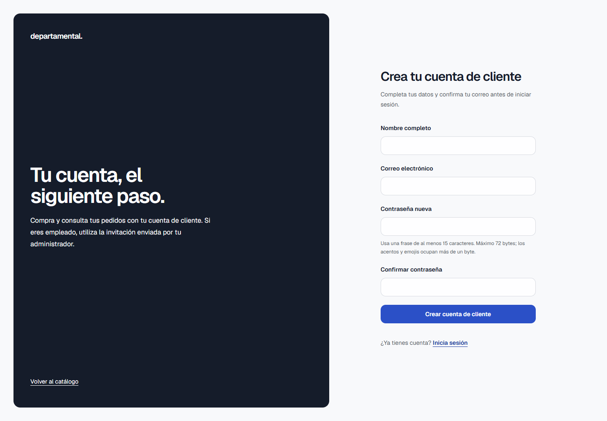
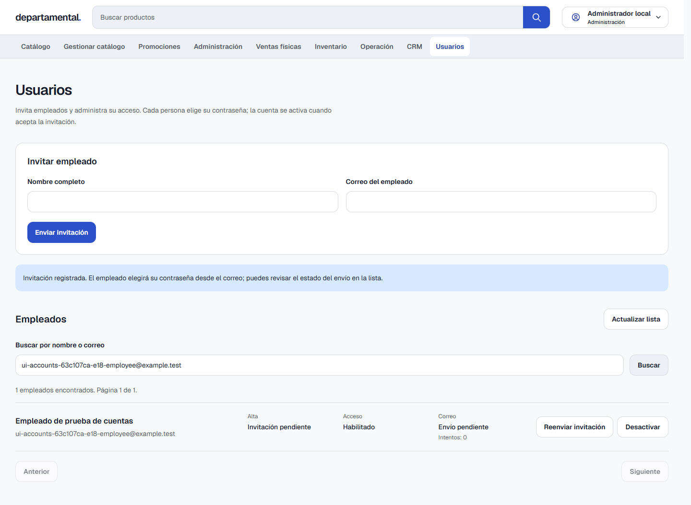

# Alta de clientes y empleados: entrega y demostración

El cliente se registra desde el login y confirma su correo. ADMIN invita empleados desde Usuarios; cada empleado establece su propia contraseña. Auth decide los roles y estos formularios no crean administradores. Los [contratos de cuentas](cuentas-contrato.md) explican sesiones, permisos y configuración.

Prepara la app con el [README principal](../README.md). En una instalación nueva, abre la web en `http://localhost:3000` y Mailpit en `http://localhost:18000`; las credenciales se consultan con `npm run credentials:local`. Si cambiaste los puertos, utiliza los valores de tu `.env`.

## Demostrar el alta de un cliente

1. Abre [la aplicación local](http://localhost:3000) sin sesión. Opcionalmente agrega un producto a la bolsa y entra a **Ver bolsa**: aparecerá el login con retorno a checkout.
2. Pulsa **Crear cuenta**. Introduce nombre, un correo nuevo y una frase de acceso de al menos 15 caracteres; repítela. No existe selector de rol.
3. Envía el registro. La respuesta pide revisar el correo; todavía no existe una sesión autorizada.
4. Abre [Mailpit](http://localhost:18000), encuentra el mensaje dirigido al correo utilizado y abre su enlace. Abrirlo no activa la cuenta: pulsa **Confirmar mi correo**.
5. Pulsa **Iniciar sesión** y utiliza tus credenciales. Si empezaste desde checkout, regresarás allí con la bolsa conservada. Selecciona una sucursal y confirma el pedido para demostrar una compra real.
6. Visita `/users`: el cliente recibe la pantalla de acceso restringido.

Mailpit captura mensajes de pruebas; no los entrega a un buzón externo. Para una demostración, usa una dirección sintética propia que no se haya utilizado antes. No muestres contraseñas, cookies ni enlaces completos en capturas compartidas.

Si confirmas el correo en otro navegador, la página solicita establecer y repetir una contraseña nueva. El enlace no inicia sesión automáticamente. Un enlace vencido o ya utilizado permite solicitar otra verificación; las respuestas públicas no revelan si existe una cuenta.

## Demostrar el alta y la administración de un empleado

1. Inicia sesión como ADMIN en la aplicación local. La cuenta de desarrollo es `admin@departamental.local`; consulta su contraseña mediante `npm run credentials:local` o en la variable privada `SEED_ADMIN_PASSWORD` de `.env`.
2. Abre **Usuarios**. Introduce nombre y un correo nuevo en **Invitar empleado** y pulsa **Enviar invitación**. ADMIN no introduce la contraseña del empleado.
3. Busca el correo en la lista. Comprueba por separado **Alta**, **Acceso** y **Correo**. El correo enviado todavía no significa que se aceptó la invitación.
4. Abre el mensaje correspondiente en Mailpit. En otra sesión del navegador, abre el enlace y establece la contraseña del empleado. Pulsa **Aceptar invitación** y después inicia sesión.
5. Comprueba que el empleado entra en `/operations` y que no aparece Usuarios en su navegación. Visitar `/users` directamente también restringe el acceso.
6. Desde ADMIN actualiza la lista. Pulsa **Desactivar**, revisa la explicación y cancela con Escape. Repite y confirma: la cuenta queda desactivada, no puede renovar sesión y sus APIs y conexiones abiertas se bloquean en un máximo de **35 segundos**.
7. Pulsa **Habilitar** y confirma. El empleado debe iniciar sesión nuevamente; las sesiones anteriores siguen revocadas. Si su invitación estaba pendiente, debes reenviarla después de habilitarlo.

Para demostrar reenvíos, utiliza un empleado todavía pendiente y espera al menos 60 segundos desde el envío anterior. **Reenviar invitación** sustituye el enlace anterior. Los conflictos por correo existente no convierten clientes ni administradores en empleados. Un reintento de la misma invitación después de perder la respuesta conserva la clave idempotente y no crea otra identidad.

## Pantallas y seguridad

| Ruta | Acceso | Función |
| --- | --- | --- |
| `/login` | Público | Iniciar sesión y entrar a Crear cuenta |
| `/register` | Público | Registro de CUSTOMER y confirmación de contraseña |
| `/verify-email` | Público con desafío válido | Confirmación explícita y recuperación mediante reenvío |
| `/accept-invitation` | Público con desafío válido | Contraseña elegida por el empleado y aceptación única |
| `/users` | ADMIN | Invitación, búsqueda paginada, estados, reenvío y habilitación |

Los formularios incluyen validación asociada a cada campo, foco en el primer error, mensajes accesibles, controles deshabilitados mientras se procesa la operación y recuperación de errores de red. Se verifican vistas de escritorio, móvil y tema oscuro. La bolsa anónima se incorpora una sola vez a la bolsa del cliente después del login; las bolsas de otras cuentas mantienen su separación. La compra sigue exigiendo un cliente autorizado.

Las contraseñas nuevas requieren 15 caracteres y como máximo 72 bytes UTF-8, sin truncamiento. Las contraseñas anteriores siguen admitidas en el login. Los tokens se leen del fragmento del enlace, se retiran de la barra y permanecen solo en memoria hasta el POST. Refrescar esa página exige volver a abrir el enlace original. Los retornos `next` se limitan a rutas locales autorizadas para el rol.

Las mutaciones del BFF validan origen y CSRF. Cookies de sesión y nonce son HTTP-only. Kong y Auth aplican límites independientes: como base, 10 intentos por IP cada 15 minutos, 60 segundos entre envíos y 3 reenvíos por hora. Las pruebas repetidas desde la misma IP deben respetar la ventana; no se eliminan contadores para evitarlos.

Los contratos, permisos, variables, cifrado, auditoría y estados del backend se describen en [Cuentas y sesiones](cuentas-contrato.md). Los estados de entrega `PENDING`, `PROCESSING`, `SENT`, `SIMULATED`, `FAILED` y `UNDELIVERABLE` son independientes del alta `PENDING_EMAIL`, `PENDING_INVITATION` o `READY`.

## Comprobaciones y correo

Las pruebas usan otro entorno: `departamental-five-phases`, con web 3105, Gateway 8005 y Mailpit 18025. No ejecutes los runners contra las bases de una instalación con datos que quieras conservar. Consulta la [verificación de cuentas](cuentas-contrato.md#verificación) y la [certificación completa](entrega-definitiva-fases-7-9.md#certificación-de-una-versión).

Para instalar el navegador de pruebas, ejecuta `npx playwright install chromium`; Linux CI usa `npx playwright install --with-deps chromium`. Los reportes excluyen contraseñas, tokens y enlaces completos. Las trazas, videos y capturas automáticas de fallos están deshabilitados.

Mailpit captura mensajes locales y no los entrega a un buzón externo. Un despliegue público requiere SMTP configurado, remitente autorizado, `APP_PUBLIC_ORIGIN` HTTPS y claves privadas independientes. El modo `log` registra `SIMULATED` y no permite completar el alta desde un correo real.

## Capturas para la demostración

Capturas del 9 de octubre de 2026: aplicación local `http://localhost:3105`, proyecto aislado `departamental-five-phases`. Son capturas reales con datos sintéticos, no maquetas. Los formularios de contraseña están vacíos y los tokens ya se retiraron de la barra. Los archivos incorporan esta procedencia en sus metadatos PNG.

| Pantalla | Escritorio | Móvil |
| --- | --- | --- |
| Registro de cliente | [Ver captura](assets/alta-cuentas/accounts-register-desktop.png) | [Ver captura](assets/alta-cuentas/accounts-register-mobile.png) |
| Confirmar correo | [Ver captura](assets/alta-cuentas/accounts-verify-desktop.png) | [Ver captura](assets/alta-cuentas/accounts-verify-mobile.png) |
| Aceptar invitación | [Ver captura](assets/alta-cuentas/accounts-invitation-desktop.png) | [Ver captura](assets/alta-cuentas/accounts-invitation-mobile.png) |
| Usuarios de ADMIN | [Ver captura](assets/alta-cuentas/accounts-users-desktop.png) | [Ver captura](assets/alta-cuentas/accounts-users-mobile.png) |
| Registro, tema oscuro | [Ver captura](assets/alta-cuentas/accounts-register-dark-desktop.png) | [Ver captura](assets/alta-cuentas/accounts-register-dark-mobile.png) |
| Usuarios, tema oscuro | [Ver captura](assets/alta-cuentas/accounts-users-dark-desktop.png) | [Ver captura](assets/alta-cuentas/accounts-users-dark-mobile.png) |

